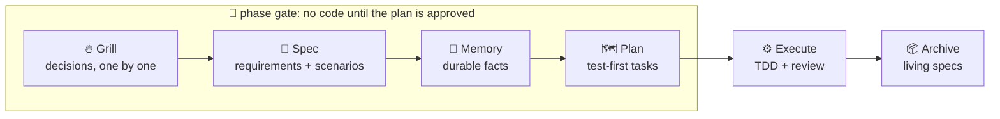

<div align="center">


# grillspec

**Spec-driven agentic development. The agent asks before it guesses.**

[](https://pypi.org/project/grillspec/)
[](https://pypi.org/project/grillspec/)
[](https://github.com/forbxpg/grillspec/actions/workflows/ci.yml)
[](LICENSE)

Claude Code · Cursor · Codex · Antigravity · GigaCode — Linux, macOS, Windows

[Русская версия](README.ru.md) · [Documentation](docs/en/README.md) · [Changelog](CHANGELOG.md)

</div>

---

Coding agents are fast, and they are confident. Ask one for "a cache on `fetch_user`"
and it will pick the expiry, the size, the invalidation rule and the storage for you,
quietly, and build all of it. Every one of those was your decision. You find out which
ones it got wrong when you read the diff, or later.

**grillspec fixes the order of work.** Before the agent builds anything that involves
a decision, it *grills* you: one decision at a time, each with its recommended answer
and the real trade-off, until nothing is left to guess. Then it writes the spec from
your answers, plans the work as test-first tasks, executes them with TDD and review,
and merges the result into living specs. A phase gate makes sure no code gets
written before the spec and plan are approved.



## Why grillspec

- **No silent guesses.** Every choice between options goes to you, with a
  recommendation you can accept with one word. Facts the agent can look up, it looks
  up; it never asks you what a file says.
- **Nothing is lost to compaction.** Every answer goes into a decision log on disk the
  moment you give it. A session that runs out of context resumes from the log, not
  from a summary of a summary.
- **Every session picks up where the last one stopped.** A local journal of events and
  the agent's handoff notes becomes a short resume brief at the next session start,
  searchable later and browsable in your browser — without a second LLM or a network
  call.
- **Specs you can test against.** Requirements carry scenarios with IDs (`WH-1`), every
  plan task names the scenarios it covers, and every test is written red-first from
  them. "Done" means a passing test, not a confident sentence.
- **Approval is bound to content.** Approving a spec or a plan records a hash of it.
  Edit the spec after approval and grillspec notices and sends you back.
- **A gate, not a suggestion.** Hooks in Claude Code, Cursor, Codex and Antigravity
  block code edits while a change is being grilled, specced or planned. Only you can
  pause the gate, from your own terminal.
- **Second opinions on demand.** A council of role subagents and other vendors' agent
  CLIs gives independent views on hard decisions, with their dissent shown in the
  question, never smoothed over.
- **Five harnesses, one workflow.** The same skills, the same CLI and the same files
  in Claude Code, Cursor, Codex, Antigravity and GigaCode.
- **Measured, not claimed.** Always-on cost was **measured at about 2,100 tokens per
  session** in Claude Code for 0.1; 0.2's memory instructions add an estimated 110,
  plus a resume brief of at most 1,500. Everything else loads only when a skill is
  used. A table generated in CI shows every skill's cost.
- **Self-contained.** No runtime dependency on any other plugin. The CLI is
  standard-library Python, found automatically by the hooks on every OS.

## What a session looks like

> **You:** add retries to the webhook sender
>
> **Agent:** This needs a few decisions first. Change slug `webhook-retries`, depth
> `standard` (Recommended — a feature, reversible). OK?
>
> **You:** ok
>
> **Agent:** **Q1. Delivery guarantee?**
> 1. **at-least-once** *(Recommended)* — retries may deliver twice; receivers dedupe
>    by event id. Cheap to reverse.
> 2. exactly-once — needs an outbox table and idempotency keys. Costly to reverse.
>
> **You:** 1
>
> **Agent:** **Q2. Retry schedule?** … *(and so on, until nothing is left to guess)*
>
> **Agent:** Here is what we agreed: … Do we share the same understanding?
>
> **You:** yes
>
> **Agent:** Grill approved. Writing the spec from the log: requirement *Retry failed
> deliveries*, scenario `WH-1 retries back off` …

Every answer above is already in `design.md` (OpenSpec) or the change's spec file
(Superpowers-style) when the next question is asked.

## How it works

### 🔥 Grilling — `grillspec-grill`

The agent maps every decision the change needs into a tree and asks the ones whose
prerequisites are settled. It recommends an answer, names the trade-off and says
whether the choice is cheap or costly to reverse. You pick the depth:

| Depth | How it asks | Budget |
|---|---|---|
| `quick` | in rounds — every open question numbered, "yes" accepts all | ≈ 5 decisions |
| `standard` | one decision at a time | ≈ 15 decisions |
| `deep` | one decision at a time; with a council, on every decision | none |

Answers land in the log with their source (`user`, `accepted`, `delegated`…), your own
words when you used them, and the alternatives you turned down. When the budget runs
out, the rest is listed with recommendations and you choose: continue, or accept
them. In a hurry and said "no questions"? The agent proceeds, but lists every choice
it made for you as an assumption you can overrule.
→ [How grilling works](docs/en/how-it-works/grilling.md)

### 🗣️ Council — `grillspec-council`

For root and hard-to-reverse decisions, a council gives independent views before you
choose: three role subagents (*simplicity*, *devil's advocate*, *risk*) and any agent
CLI you have installed and logged in — `claude`, `codex`, `cursor-agent`, `gemini`,
`agy`, `gigacode`. External members get one prompt in an empty temporary directory,
in read-only or planning mode. The result is one line in the question:

```text
Council 3/4: A (claude, codex, simplicity) · dissent devil→B: retries hide outages · gemini: timeout
```

The council advises; you decide. Members that run on the same model agreeing is
called out as a weak signal. Only GigaCode on the machine? It sits on the council
itself, headless and without extensions.
→ [How the council works](docs/en/how-it-works/council.md)

### 📜 Specs — `grillspec-specs`

The spec is written from the log, not from memory: requirements with `SHALL`, and
scenarios in `WHEN`/`THEN` with IDs. Pick a backend per project:

| Backend | Layout | Fits |
|---|---|---|
| `openspec` | living specs in `openspec/specs/`, one change folder with deltas per change — compatible with the OpenSpec CLI | long-lived codebases |
| `superpowers` | one dated spec and one plan per change in `docs/grillspec/` | new projects, one-off features |

`grillspec validate` checks structure, scenario IDs and deltas against the living
specs; `grillspec approve spec` refuses a spec with errors and records its hash.
→ [How specs work](docs/en/how-it-works/specs.md)

### 🧠 Memory — `grillspec-memory`

After the spec, the agent proposes durable facts from the log — commands, conventions,
constraints, gotchas — and you approve each. Short ones go into a managed block in
`AGENTS.md` that every harness reads (capped at 40 entries of 160 characters, so it
stays cheap); long ones go to `docs/grillspec/memory/`. Secrets never make it in.
→ [How memory works](docs/en/how-it-works/memory.md)

### 🗺️ Plans — `grillspec-plans`

One plan format for both backends, and a valid OpenSpec `tasks.md`. Every task names
its files, the interfaces it consumes and produces, the scenarios it **Covers:**, and
its **Test:** strategy:

| `Test:` | What it means |
|---|---|
| `scenario-first` | the scenario tests are written and seen failing before any code |
| `reproduce-first` | a bug is reproduced by a failing test before the fix |
| `characterization` | today's behaviour is pinned before a refactor |
| `none: <reason>` | glue or prose, with the reason on record |

The plan is validated against the spec (every scenario covered) and approved by
hash; ticking boxes does not invalidate the approval.
→ [How plans work](docs/en/how-it-works/plans.md)

### ⚙️ Execution — `grillspec-subagent-execution`, `grillspec-inline-execution`

You choose the executor: a fresh subagent per task with a reviewer after each, or the
agent itself with one fresh whole-branch review at the end. Either way:
`grillspec exec` writes each task's brief, ticks the box **only when the task's tests
pass**, and keeps a ledger that survives compaction. Around it: TDD, systematic
debugging, verification before any "done", code review in both directions, git
worktrees and branch finishing — adapted from [Superpowers](https://github.com/obra/superpowers).
→ [How execution works](docs/en/how-it-works/execution.md)

### 🧭 Session memory — `grillspec note`, `recall`, `ui`

grillspec records its own events — a change started, an approval, a finished task, an
archive — and the agent adds one-line notes: a `handoff` before the session ends (done,
next, open) and a `discovery`, `blocker` or `todo` the moment it happens. The next
session starts with a resume brief of at most 1,500 tokens: the active change and
phase, pinned notes, the latest handoff, open blockers and todos, recent events.
`grillspec recall <words>` searches the rest (Russian too), and `grillspec ui` opens a
local, token-guarded page with the timeline, search, pin and delete.

The journal is a SQLite file in `.grillspec/journal/` that git never sees. Secrets and
`<private>` text are dropped before storage; command output and file contents are never
stored. No second model summarises your session, so it costs nothing extra and works
offline — GigaCode included.
→ [How session memory works](docs/en/how-it-works/session-memory.md)

### 📦 Archive — `grillspec-archive`

When the plan is done, `grillspec archive --dry-run` shows exactly what will change,
and on your yes the change's deltas merge into the living specs (RENAMED → REMOVED →
MODIFIED → ADDED, like OpenSpec). It refuses — writing nothing — when a modified
requirement would drop a scenario, a rename has no source, or the spec changed after
approval; a failed write is rolled back.
→ [How archiving works](docs/en/how-it-works/archive.md)

### 🚧 Phase gates

While a change is grilled, specced or planned, a pre-tool hook denies edits outside
the change's own artifacts and obvious shell writes (`>`, `rm`, `sed -i`, `git
restore`…), with one line telling the agent what to finish first:

```text
grillspec gate: add-limits is in the spec phase, so only its spec artifacts may change; src/app.py is outside them. Next: write the spec, grillspec validate, then approve. To bypass, the user runs grillspec gate pause in their own terminal.
```

It fails open (a broken install never blocks you), the agent cannot pause it, and you
can: `grillspec gate pause` in your own terminal asks for confirmation and lasts one
phase. It is a guardrail against drift, not a sandbox.
→ [How phase gates work](docs/en/how-it-works/gates.md)

## Install

| Harness | Command |
|---|---|
| Claude Code | `claude plugin marketplace add forbxpg/grillspec && claude plugin install grillspec@grillspec` |
| Cursor | `/add-plugin forbxpg/grillspec` |
| Codex | `codex plugin marketplace add forbxpg/grillspec`, then `/plugins` |
| Antigravity | `agy plugin install https://github.com/forbxpg/grillspec` |
| GigaCode | `gigacode extensions link /path/to/grillspec` — a local folder; no npx or network needed |

Any harness without its plugin system: `grillspec install --harness <name> --copy`. No
npx or uv on the machine? Clone the repo, unpack a release, or `pip download` it from a
PyPI mirror, and run `sh scripts/grillspec` from the folder — see [Installation](docs/en/installation.md#without-npx-or-uv).
Then, in your project, ask the agent to **"set up grillspec"** — it detects your
project, recommends a backend and shows every file it will touch before it writes.

Requirements: Python 3.11–3.15 for the hooks and CLI (found automatically; nothing to
configure), git.

## Support

| Harness | Status | Verified by smoke runs |
|---|---|---|
| Claude Code | ✅ supported | session start and phase gate |
| Cursor | ✅ supported | session start and phase gate (`cursor-agent`) |
| Antigravity | ✅ supported | session start and phase gate (`agy` CLI; the IDE is not yet tested) |
| Codex | ⚠️ unverified | its plugin hooks need `/hooks` approval after each update |
| GigaCode | 🧪 experimental | a native extension with phase gates, checked against the GigaCode 0.13.1 bundle; not yet run live (needs a licence); hooks must be enabled |

## Command line

The skills drive the CLI for you; you rarely type these yourself.

| Command | What it does |
|---|---|
| `grillspec status` | the phase of this working tree and the next step |
| `grillspec init --backend <b>` | set grillspec up in a project (`--dry-run` lists every write) |
| `grillspec new <slug>` | start a change and its decision log |
| `grillspec approve grill\|spec\|plan` | record an approval, bound to the artifact's content |
| `grillspec validate` | check a change's spec and plan |
| `grillspec council ask` | ask external agent CLIs about one decision |
| `grillspec memory list\|add\|retire` | the project memory block in `AGENTS.md` |
| `grillspec exec workspace\|start\|done\|review-package` | execution helpers: briefs, ticks, review packages |
| `grillspec archive [--dry-run]` | merge a done change into the living specs |
| `grillspec gate pause\|resume` | pause the phase gate (yours only, from a terminal) |
| `grillspec note <kind> -- <text>` | a session-memory note: `handoff`, `discovery`, `blocker`, `todo` |
| `grillspec recall [words] [--brief\|--pin\|--resolve\|--forget]` | search session memory, show the brief, pin, resolve or delete |
| `grillspec ui` | the local session-memory viewer in your browser |
| `grillspec tokens [--project]` | estimate what grillspec costs in context |
| `grillspec install\|uninstall --harness <h>` | copy the skills into a harness, and remove exactly that |

## Configuration

`.grillspec/config.toml` in the project, over your user config, over the defaults:

```toml
version = 1

[spec]
backend = "openspec"          # or "superpowers"
artifacts_language = "auto"   # specs and plans follow your project's docs

[grill]
depth = "standard"            # quick | standard | deep

[council]
enabled = "ask"               # ask | yes | no
external = "allow"            # "never" keeps the council to local subagents

[gates]
enabled = true
allow = []                    # extra globs the gate lets the agent edit
```

→ [Every key](docs/en/configuration.md)

## What it costs

| Part | Loaded | ≈ tokens |
|---|---|---|
| router and status line | every session | 1,343 |
| skill catalogue (18 skills) | every session | 844 |
| your memory block | every session | depends on it |
| session-memory brief | every session | at most 1,500 |
| any one skill | only when it is used | 360 – 5,000 |

Measured in Claude Code with and without grillspec: **2,089 and 2,095 tokens** of
overhead per session. Skills are English-only for this reason; the human docs are
bilingual because no agent ever loads them.
→ [What grillspec costs in tokens](docs/en/tokens.md)

## Data and privacy

grillspec collects no personal data and runs no service of its own: its CLI and hooks
work on files in your project. One feature sends data elsewhere — the **council**.
When a grilling session uses it (`council.enabled` is `ask` by default, so you are
asked each time), the question and its context go as a prompt to the agent CLIs
installed and logged in on your machine (`claude`, `codex`, `cursor-agent`, `gemini`,
`agy`, `gigacode`), under your own accounts with those vendors. Set
`council.external = "never"` to keep the council to local subagents.
→ [How the council works](docs/en/how-it-works/council.md)

## Quality

Every release passes: ruff with every rule and basedpyright in strict mode; unit tests
on Linux, macOS and Windows for Python 3.11–3.14; `claude plugin validate --strict`
and `agy plugin validate`; behavioural evals that put the skills under pressure ("just
do it, no questions", "skip the test", "skip the plan"); and smoke runs in real
harnesses. The checklist is in [CONTRIBUTING.md](CONTRIBUTING.md#releasing-maintainer).

## Status

`0.1.x`: everything above is in place and released. 0.x versions may still change
file formats; the [changelog](CHANGELOG.md) says when.

## Credits

grillspec stands on the shoulders of [Superpowers](https://github.com/obra/superpowers)
(execution, TDD, debugging and review skills, adapted), [OpenSpec](https://github.com/Fission-AI/OpenSpec)
(the living-spec format), [mattpocock/skills](https://github.com/mattpocock/skills)
and claude-council. See [NOTICE](NOTICE).

MIT — see [LICENSE](LICENSE).
