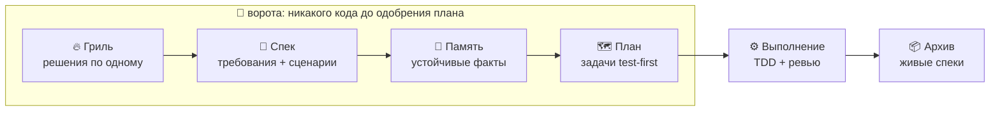

<div align="center">


# grillspec

**Spec-driven разработка с агентами. Агент спрашивает, прежде чем угадывать.**

[](https://pypi.org/project/grillspec/)
[](https://pypi.org/project/grillspec/)
[](https://github.com/forbxpg/grillspec/actions/workflows/ci.yml)
[](LICENSE)

Claude Code · Cursor · Codex · Antigravity · GigaCode — Linux, macOS, Windows

[English version](README.md) · [Документация](docs/ru/README.md) · [Changelog](CHANGELOG.md)

</div>

---

Агенты для кода быстрые и уверенные в себе. Попросите «кэш на `fetch_user`» — и агент
сам выберет время жизни, размер, правило инвалидации и хранилище, молча, и всё это
построит. Каждое из этих решений было вашим. Какие из них он угадал неверно, вы узнаете,
когда прочтёте дифф, — или позже.

**grillspec наводит порядок в работе.** Прежде чем агент построит что-то, где есть
решение, он вас *грилит*: по одному решению за раз, к каждому — рекомендованный ответ и
настоящий компромисс, пока угадывать станет нечего. Потом он пишет спек из ваших
ответов, планирует работу задачами test-first, выполняет их через TDD и ревью и вливает
результат в живые спеки. Ворота между фазами следят, чтобы ни строчки кода не
появилось до одобрения спека и плана.



## Почему grillspec

- **Никаких молчаливых догадок.** Каждый выбор между вариантами идёт к вам, с
  рекомендацией, которую можно принять одним словом. Факты, которые можно посмотреть,
  агент смотрит сам; он никогда не спросит вас, что написано в файле.
- **Ничего не теряется при сжатии контекста.** Каждый ответ записывается в журнал
  решений на диске в момент ответа. Сессия, у которой кончился контекст, продолжает с
  журнала, а не с пересказа пересказа.
- **Спеки, по которым можно тестировать.** У требований есть сценарии с ID (`WH-1`),
  каждая задача плана называет сценарии, которые покрывает, и каждый тест пишется
  сначала красным. «Готово» — это проходящий тест, а не уверенная фраза.
- **Одобрение привязано к содержимому.** Одобряя спек или план, grillspec записывает
  его хеш. Поправили спек после одобрения — grillspec заметит и вернёт вас назад.
- **Ворота, а не пожелание.** Хуки в Claude Code, Cursor, Codex и Antigravity блокируют
  правки кода, пока изменение грилят, специфицируют или планируют. Поставить ворота на
  паузу можете только вы, в своём терминале.
- **Второе мнение по запросу.** Council из ролевых субагентов и агентских CLI других
  вендоров даёт независимые взгляды на трудные решения, а несогласие показывается прямо
  в вопросе, без сглаживания.
- **Пять харнессов, один процесс.** Те же скиллы, тот же CLI и те же файлы в Claude
  Code, Cursor, Codex, Antigravity и GigaCode.
- **Измерено, а не заявлено.** Постоянная цена — **около 2 100 токенов на сессию**,
  измерено в Claude Code; всё остальное загружается, только когда скилл используется.
  Таблица цены каждого скилла генерируется в CI.
- **Самодостаточный.** Никаких зависимостей от других плагинов во время работы. CLI —
  Python на одной стандартной библиотеке, хуки находят его сами на любой ОС.

## Как выглядит сессия

> **Вы:** добавь ретраи в отправку вебхуков
>
> **Агент:** Сначала нужно несколько решений. Слаг изменения `webhook-retries`, глубина
> `standard` (Рекомендуется — фича, обратимо). Ок?
>
> **Вы:** ок
>
> **Агент:** **Q1. Гарантия доставки?**
> 1. **at-least-once** *(Рекомендуется)* — ретраи могут доставить дважды; получатели
>    отсеивают дубли по id события. Дёшево откатить.
> 2. exactly-once — нужна outbox-таблица и ключи идемпотентности. Дорого откатить.
>
> **Вы:** 1
>
> **Агент:** **Q2. Расписание ретраев?** … *(и так далее, пока угадывать нечего)*
>
> **Агент:** Вот о чём мы договорились: … Мы понимаем это одинаково?
>
> **Вы:** да
>
> **Агент:** Гриль одобрен. Пишу спек по журналу: требование *Retry failed
> deliveries*, сценарий `WH-1 retries back off` …

Каждый ответ выше уже лежит в `design.md` (OpenSpec) или в файле спека изменения
(Superpowers-стиль) к моменту следующего вопроса.

## Как это работает

### 🔥 Гриль — `grillspec-grill`

Агент раскладывает все решения изменения в дерево и спрашивает те, у которых решены
предпосылки. Он рекомендует ответ, называет компромисс и говорит, дёшево или дорого
этот выбор откатить. Глубину выбираете вы:

| Глубина | Как спрашивает | Бюджет |
|---|---|---|
| `quick` | раундами — все открытые вопросы с номерами, «да» принимает все | ≈ 5 решений |
| `standard` | по одному решению | ≈ 15 решений |
| `deep` | по одному решению; с council — на каждом | без лимита |

Ответы попадают в журнал с источником (`user`, `accepted`, `delegated`…), вашими
словами, если вы отвечали своими словами, и отвергнутыми вариантами. Кончился бюджет —
остальное выводится списком с рекомендациями, и вы решаете: продолжить или принять. Вы
торопитесь и сказали «без вопросов»? Агент продолжит, но перечислит каждый выбор,
сделанный за вас, как допущение, которое можно отменить.
→ [Как работает гриль](docs/ru/how-it-works/grilling.md)

### 🗣️ Council — `grillspec-council`

Для корневых и трудно обратимых решений council даёт независимые взгляды до того, как
вы выберете: три ролевых субагента (*простота*, *адвокат дьявола*, *риск*) и любой
установленный и залогиненный агентский CLI — `claude`, `codex`, `cursor-agent`,
`gemini`, `agy`, `gigacode`. Внешние участники получают один промпт в пустой временной
папке, в режиме только чтения или планирования. Результат — одна строка в вопросе:

```text
Council 3/4: A (claude, codex, simplicity) · dissent devil→B: retries hide outages · gemini: timeout
```

Council советует; решаете вы. Согласие участников на одной модели честно помечается как
слабый сигнал.
→ [Как работает council](docs/ru/how-it-works/council.md)

### 📜 Спеки — `grillspec-specs`

Спек пишется по журналу, а не по памяти: требования с `SHALL` и сценарии `WHEN`/`THEN`
с ID. Бэкенд выбирается на проект:

| Бэкенд | Структура | Подходит |
|---|---|---|
| `openspec` | живые спеки в `openspec/specs/`, на каждое изменение папка с дельтами — совместимо с OpenSpec CLI | долгоживущие кодовые базы |
| `superpowers` | один датированный спек и один план на изменение в `docs/grillspec/` | новые проекты, разовые фичи |

`grillspec validate` проверяет структуру, ID сценариев и дельты относительно живых
спеков; `grillspec approve spec` не примет спек с ошибками и запишет его хеш.
→ [Как работают спеки](docs/ru/how-it-works/specs.md)

### 🧠 Память — `grillspec-memory`

После спека агент предлагает устойчивые факты из журнала — команды, соглашения,
ограничения, подводные камни — и вы одобряете каждый. Короткие попадают в управляемый
блок в `AGENTS.md`, который читают все харнессы (не больше 40 записей по 160 символов,
чтобы он оставался дешёвым); длинные — в `docs/grillspec/memory/`. Секреты туда не
попадают.
→ [Как работает память](docs/ru/how-it-works/memory.md)

### 🗺️ Планы — `grillspec-plans`

Один формат плана для обоих бэкендов, и при этом валидный OpenSpec `tasks.md`. Каждая
задача называет свои файлы, интерфейсы, которые она потребляет и производит, сценарии,
которые она покрывает (**Covers:**), и стратегию тестов (**Test:**):

| `Test:` | Что значит |
|---|---|
| `scenario-first` | тесты сценариев пишутся и падают до любого кода |
| `reproduce-first` | баг воспроизводится падающим тестом до исправления |
| `characterization` | текущее поведение фиксируется до рефакторинга |
| `none: <причина>` | связующий код или текст, причина записана |

План проверяется по спеку (каждый сценарий покрыт) и одобряется по хешу; отметки
задач одобрение не сбрасывают.
→ [Как работают планы](docs/ru/how-it-works/plans.md)

### ⚙️ Выполнение — `grillspec-subagent-execution`, `grillspec-inline-execution`

Исполнителя выбираете вы: свежий субагент на каждую задачу с ревьюером после каждой —
или сам агент и одно свежее ревью всей ветки в конце. В любом случае `grillspec exec`
пишет бриф каждой задачи, отмечает её **только когда её тесты проходят** и ведёт
журнал, который переживает сжатие контекста. Вокруг — TDD, систематическая отладка,
проверка перед любым «готово», ревью в обе стороны, git worktrees и завершение ветки —
адаптировано из [Superpowers](https://github.com/obra/superpowers).
→ [Как работает выполнение](docs/ru/how-it-works/execution.md)

### 📦 Архив — `grillspec-archive`

Когда план выполнен, `grillspec archive --dry-run` показывает, что именно изменится, и
после вашего «да» дельты изменения вливаются в живые спеки (RENAMED → REMOVED →
MODIFIED → ADDED, как в OpenSpec). Архив отказывает — и ничего не пишет, — если
изменённое требование потеряло бы сценарий, у переименования нет источника или спек
поменялся после одобрения; сорвавшаяся запись откатывается.
→ [Как работает архив](docs/ru/how-it-works/archive.md)

### 🚧 Ворота между фазами

Пока изменение грилят, специфицируют или планируют, pre-tool хук запрещает правки за
пределами артефактов изменения и очевидную запись из shell (`>`, `rm`, `sed -i`,
`git restore`…) и одной строкой говорит агенту, что закончить сначала:

```text
grillspec gate: add-limits is in the spec phase, so only its spec artifacts may change; src/app.py is outside them. Next: write the spec, grillspec validate, then approve. To bypass, the user runs grillspec gate pause in their own terminal.
```

При сбое хук пропускает вызов (сломанная установка вас никогда не заблокирует), агент
не может снять ворота, а вы можете: `grillspec gate pause` в вашем терминале
переспрашивает и действует одну фазу. Это ограждение от дрейфа, а не песочница.
→ [Как работают ворота](docs/ru/how-it-works/gates.md)

## Установка

| Харнесс | Команда |
|---|---|
| Claude Code | `claude plugin marketplace add forbxpg/grillspec && claude plugin install grillspec@grillspec` |
| Cursor | `/add-plugin forbxpg/grillspec` |
| Codex | `codex plugin marketplace add forbxpg/grillspec`, затем `/plugins` |
| Antigravity | `agy plugin install https://github.com/forbxpg/grillspec` |
| GigaCode | `gigacode extensions link /path/to/grillspec` — локальная папка; ни npx, ни сеть не нужны |

Харнесс без системы плагинов: `grillspec install --harness <name> --copy`. На машине нет
npx и uv? Клонируйте репозиторий, распакуйте релиз или скачайте его `pip download` из
зеркала PyPI и запускайте `sh scripts/grillspec` из папки — см. [Установку](docs/ru/installation.md#без-npx-и-uv). Затем
в проекте попросите агента **«set up grillspec»** — он изучит проект, порекомендует
бэкенд и покажет каждый файл, который тронет, прежде чем что-то записать.

Нужно: Python 3.11–3.15 для хуков и CLI (находится сам, настраивать ничего не надо), git.

## Поддержка

| Харнесс | Статус | Проверено smoke-прогонами |
|---|---|---|
| Claude Code | ✅ поддерживается | бутстрап и ворота |
| Cursor | ✅ поддерживается | бутстрап и ворота (`cursor-agent`) |
| Antigravity | ✅ поддерживается | бутстрап и ворота (CLI `agy`; IDE пока не проверена) |
| Codex | ⚠️ не проверен | хукам плагина нужно одобрение через `/hooks` после каждого обновления |
| GigaCode | 🧪 экспериментальный | нативное расширение с воротами, сверено со сборкой GigaCode 0.13.1; вживую ещё не запускалось (нужна лицензия); хуки нужно включить |

## Командная строка

CLI вызывают скиллы; сами вы набираете эти команды редко.

| Команда | Что делает |
|---|---|
| `grillspec status` | фаза рабочего дерева и следующий шаг |
| `grillspec init --backend <b>` | подключить grillspec к проекту (`--dry-run` покажет все записи) |
| `grillspec new <slug>` | начать изменение и его журнал решений |
| `grillspec approve grill\|spec\|plan` | записать одобрение, привязанное к содержимому |
| `grillspec validate` | проверить спек и план изменения |
| `grillspec council ask` | спросить внешние агентские CLI об одном решении |
| `grillspec memory list\|add\|retire` | блок памяти проекта в `AGENTS.md` |
| `grillspec exec workspace\|start\|done\|review-package` | помощники выполнения: брифы, отметки, пакеты ревью |
| `grillspec archive [--dry-run]` | влить готовое изменение в живые спеки |
| `grillspec gate pause\|resume` | пауза ворот (только ваша, из терминала) |
| `grillspec tokens [--project]` | оценить, сколько grillspec стоит в контексте |
| `grillspec install\|uninstall --harness <h>` | скопировать скиллы в харнесс и удалить ровно это |

## Настройка

`.grillspec/config.toml` в проекте, поверх вашего пользовательского конфига, поверх
значений по умолчанию:

```toml
version = 1

[spec]
backend = "openspec"          # или "superpowers"
artifacts_language = "auto"   # спеки и планы следуют языку документации проекта

[grill]
depth = "standard"            # quick | standard | deep

[council]
enabled = "ask"               # ask | yes | no
external = "allow"            # "never" оставляет в council только локальных субагентов

[gates]
enabled = true
allow = []                    # доп. glob, которые ворота разрешают агенту править
```

→ [Все ключи](docs/ru/configuration.md)

## Сколько это стоит

| Часть | Когда загружается | ≈ токенов |
|---|---|---|
| роутер и строка статуса | каждая сессия | 1 249 |
| каталог скиллов (18 скиллов) | каждая сессия | 844 |
| ваш блок памяти | каждая сессия | зависит от него |
| любой один скилл | только когда используется | 360 – 5 000 |

Измерено в Claude Code с grillspec и без: **2 089 и 2 095 токенов** накладных расходов
на сессию. Поэтому скиллы только на английском; документация для людей двуязычная,
потому что агент её никогда не загружает.
→ [Сколько grillspec стоит в токенах](docs/ru/tokens.md)

## Данные и приватность

grillspec не собирает персональные данные и не держит собственного сервиса: CLI и хуки
работают с файлами вашего проекта. Отправляет данные наружу только одна функция —
**council**. Когда гриль его использует (`council.enabled` по умолчанию `ask`, то есть
вас спрашивают каждый раз), вопрос и его контекст уходят промптом в агентские CLI,
установленные и залогиненные на вашей машине (`claude`, `codex`, `cursor-agent`,
`gemini`, `agy`, `gigacode`), под вашими же аккаунтами у этих вендоров.
`council.external = "never"` оставляет в council только локальных субагентов.
→ [Как работает council](docs/ru/how-it-works/council.md)

## Качество

Каждый релиз проходит: ruff со всеми правилами и basedpyright в строгом режиме;
юнит-тесты на Linux, macOS и Windows для Python 3.11–3.14; `claude plugin validate
--strict` и `agy plugin validate`; поведенческие eval'ы, которые давят на скиллы
(«просто сделай, без вопросов», «пропусти тест», «пропусти план»); smoke-прогоны в
настоящих харнессах. Чеклист — в [CONTRIBUTING.md](CONTRIBUTING.md#releasing-maintainer).

## Статус

`0.1.x`: всё описанное выше готово и выпущено. В версиях 0.x форматы файлов ещё могут
меняться; [changelog](CHANGELOG.md) об этом сообщает.

## Благодарности

grillspec стоит на плечах [Superpowers](https://github.com/obra/superpowers) (скиллы
выполнения, TDD, отладки и ревью, адаптированы), [OpenSpec](https://github.com/Fission-AI/OpenSpec)
(формат живых спеков), [mattpocock/skills](https://github.com/mattpocock/skills) и
claude-council. См. [NOTICE](NOTICE).

MIT — см. [LICENSE](LICENSE).
